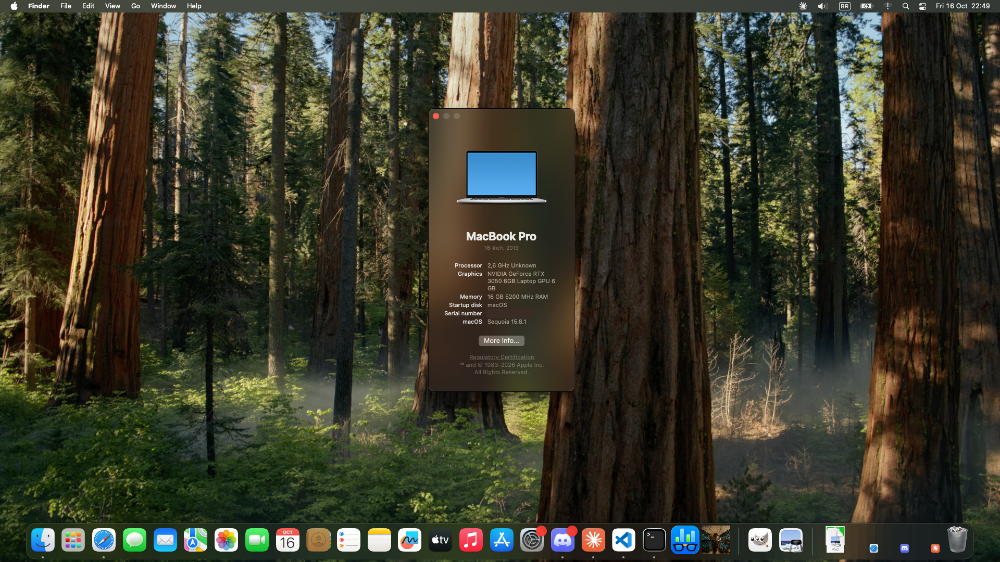

# Acer Nitro V 15 (ANV15-51) — macOS Sequoia

Bare-metal OpenCore EFI for the Acer Nitro V 15 ANV15-51 (i5-13420H, RTX 3050 Laptop), running macOS 15.8.1 with a
**hardware-accelerated desktop on the internal panel**.

## How the graphics work

The panel is wired only to the Intel iGPU (Raptor Lake, no macOS driver), and the laptop has no MUX. So the RTX 3050
composites the whole desktop with Metal 3, using [nullmoth's NVIDIA driver](https://github.com/nullmoth/nvidia-macos-driver),
and a custom framebuffer (NMIntelFB) shows each frame on the Intel-wired panel. Animations, transparency and video
playback work, and it turns on by itself at boot. Details and patches: [nmx-intel](https://github.com/kitsuneislife/nmx-intel).

## Status

| | |
|---|---|
| Graphics: accelerated desktop (RTX 3050, Metal 3) on the internal 1080p 144 Hz panel, automatic at boot | ✅ |
| Brightness | ✅ |
| CPU (4P+4E, power management) | ✅ |
| Keyboard, touchpad (I2C) | ✅ |
| Battery status | ✅ |
| Ethernet (RTL8111) | ✅ |
| Audio (ALC245) | ⚠️ speakers detected |
| Wi-Fi (MT7921): native Wi-Fi menu, 5 GHz, ~37 Mbit/s up and down | ✅ |
| Sleep | ❌ S3 resets the Intel display engine and the panel is not relit after wake; sleep is disabled |
| Bluetooth | ⏳ not tested yet |

## Drivers

- **OpenCore** 1.0.8, SMBIOS `MacBookPro16,1`
- **acidanthera:** Lilu, VirtualSMC (SMCProcessor, SMCBatteryManager), AppleALC, RestrictEvents, NVMeFix,
  BrightnessKeys, VoodooPS2
- **Input:** VoodooI2C + VoodooI2CHID
- **Other:** ECEnabler, RealtekRTL8111, AMFIPass
- **Graphics:** nullmoth's NVRM / NVAccel / NVRMFB (NVIDIA driver 2.3.6, with the nmx-intel patches) and NMIntelFB (panel), installed in `/Library/Extensions`
- **Wi-Fi:** AirportMtkWlan (see below), installed in `/Library/Extensions`

`tools/build.sh` downloads pinned releases (SHA-256 checked, [tools/sources.tsv](tools/sources.tsv)), and
`tools/make_config.py` writes `config.plist`. ACPI sources are in [acpi/](acpi/).

## Wi-Fi

The MediaTek MT7921 (`14c3:7961`) runs on [flxxxxddd's AirportMtkWlan](https://github.com/flxxxxddd/SimpleMtkWlan)
(v1.5.0, built for Sequoia's IO80211) with five patches from nmx-intel. The most important one fixes the upload:
the driver sent every data frame at the lowest fixed rate with block ack off, so upload was stuck at ~5 Mbit/s. It
now matches the download. The Wi-Fi menu, Keychain joins and 5 GHz VHT80 all work. It isn't part of the EFI. Build
it from source and install it in `/Library/Extensions` with nmx-intel's
[`tools/wifi/build-airport.sh`](https://github.com/kitsuneislife/nmx-intel/blob/main/tools/wifi/build-airport.sh) and
`install.sh airport`. The only EFI requirement is `DisableIoMapper`, which this config already sets. Holding Space
in OpenCore and picking "Start once without NVIDIA driver" (`-nvoff`) also keeps the Wi-Fi driver off the card.
Details: [nmx-intel/docs/knowledge/wifi.md](https://github.com/kitsuneislife/nmx-intel/blob/main/docs/knowledge/wifi.md).

## Not included

No Apple software and no SMBIOS identifiers: generate your own serial, MLB, ROM and SystemUUID.

## Credits

[OpenCore](https://github.com/acidanthera/OpenCorePkg) and acidanthera, [nullmoth](https://github.com/nullmoth/nvidia-macos-driver),
VoodooI2C, [flxxxxddd](https://github.com/flxxxxddd/SimpleMtkWlan) and the SimpleMtkWlan authors, [Dortania](https://dortania.github.io/). Research and education only; use at your own risk.

  
  
kitsuneislife, 2026

